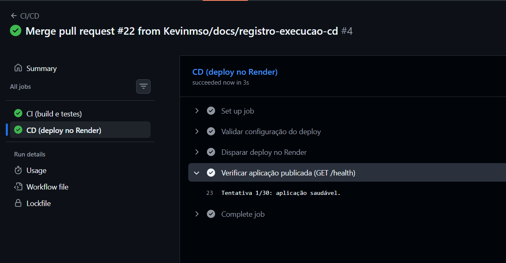
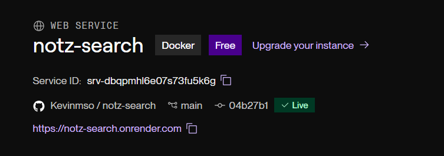
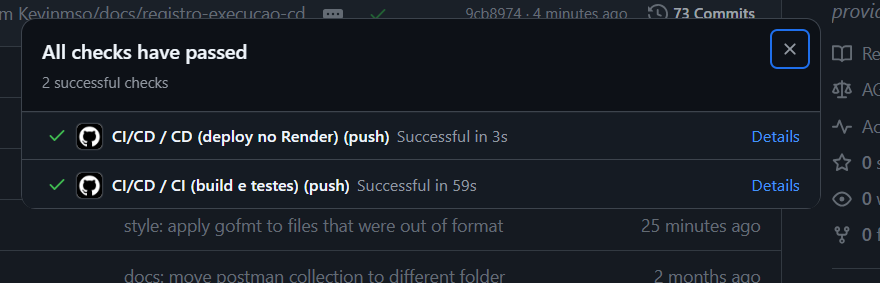

# Lab DevOps — Pipeline CI/CD com IA Generativa

**Aluno:** Kevin de Oliveira  
**Projeto:** notz-search (serviço de busca semântica em Go)  
**Repositório:** https://github.com/Kevinmso/notz-search  
**Ferramenta de IA:** Claude Code (modelo Claude Sonnet 5.5), com um subagente executando os prompts de construção da pipeline  
**Serviço de deploy:** Render (Web Service com Docker)  
**URL da aplicação publicada:** https://notz-search.onrender.com

---

## 1. O projeto

O notz-search é uma API HTTP em Go (framework Chi) que indexa notas do Obsidian como vetores no Qdrant e faz busca semântica. Os embeddings vêm de uma API externa (Cohere ou Gemini). A configuração é toda por variáveis de ambiente, e o serviço expõe `GET /health`.

O projeto já tinha testes unitários em todos os pacotes, mas não tinha pipeline, Dockerfile nem deploy.

## 2. Estratégia de deployment e justificativa

- **Render + Docker.** O enunciado cita o Render para aplicações que precisam de backend, que é o caso: é uma API stateless, não um site estático.
- **Docker** garante que o ambiente de build é o mesmo no CI e em produção. O serviço é um binário Go estático, então a imagem final (distroless, usuário não-root) é pequena e tem superfície de ataque reduzida.
- **Qdrant Cloud** já era usado pelo projeto, então a aplicação publicada só precisa das variáveis de ambiente. Os segredos ficam no painel do Render e no GitHub Secrets, nunca no repositório.
- **Deploy Hook.** O Render só builda e publica quando o GitHub Actions chama a URL do hook, depois da CI passar. O *auto-deploy* do Render fica desligado para que a pipeline seja a única origem de deploys.
- **Verificação pós-deploy.** O job de CD consulta `GET /health` da URL pública e falha se não receber `ok`. Assim o fluxo CI → CD → aplicação publicada é verificado pela própria pipeline.

## 3. Como a pipeline atende ao enunciado

| Requisito | Onde está |
|---|---|
| CI a cada push na `main` | `on.push.branches: [main]` |
| CI em `pull_request` para a `main` | `on.pull_request.branches: [main]` |
| Checkout do projeto | `actions/checkout` |
| Configurar o ambiente | `actions/setup-go`, com a versão lida do `go.mod` |
| Instalar dependências | `go mod download` |
| Teste, validação ou verificação | `gofmt`, `go vet`, `go build`, `go test -race -cover` e `docker build` |
| CD só após push na `main` | job `cd` com `if: github.event_name == 'push' && github.ref == 'refs/heads/main'` |
| CD só se a CI passar | job `cd` com `needs: ci` |
| Deploy numa nova versão acessível | `POST` no Deploy Hook do Render e verificação de `/health` |

## 4. Arquivo da pipeline (`.github/workflows/ci-cd.yml`)

```yaml
name: CI/CD

on:
  push:
    branches: [main]
  pull_request:
    branches: [main]

# Permissões mínimas: os jobs só precisam ler o código.
permissions:
  contents: read

jobs:
  ci:
    name: CI (build e testes)
    runs-on: ubuntu-latest
    timeout-minutes: 10
    steps:
      - name: Checkout
        uses: actions/checkout@v5

      - name: Configurar Go
        uses: actions/setup-go@v6
        with:
          go-version-file: go.mod
          cache: true

      - name: Instalar dependências
        run: go mod download

      - name: Verificar formatação (gofmt)
        run: |
          unformatted="$(gofmt -l .)"
          if [ -n "$unformatted" ]; then
            echo "Arquivos fora do padrão gofmt:"
            echo "$unformatted"
            exit 1
          fi

      - name: Análise estática (go vet)
        run: go vet ./...

      - name: Build
        run: go build ./...

      - name: Testes
        run: go test -race -cover ./...

      # Valida o Dockerfile antes do CD: só builda a imagem localmente,
      # sem push, sem login em registry e sem secrets.
      - name: Build da imagem Docker
        run: docker build --tag notz-search:ci .

  cd:
    name: CD (deploy no Render)
    needs: ci
    # Só em push na main: em pull_request o CI roda, mas não há deploy.
    if: github.event_name == 'push' && github.ref == 'refs/heads/main'
    runs-on: ubuntu-latest
    timeout-minutes: 20
    # Evita dois deploys simultâneos; o mais novo espera o atual terminar.
    concurrency:
      group: deploy-production
      cancel-in-progress: false
    env:
      RENDER_DEPLOY_HOOK_URL: ${{ secrets.RENDER_DEPLOY_HOOK_URL }}
      APP_URL: ${{ vars.APP_URL }}
    steps:
      - name: Validar configuração do deploy
        run: |
          if [ -z "$RENDER_DEPLOY_HOOK_URL" ]; then
            echo "::error::Secret RENDER_DEPLOY_HOOK_URL não configurado"
            exit 1
          fi
          if [ -z "$APP_URL" ]; then
            echo "::error::Variável de repositório APP_URL não configurada"
            exit 1
          fi

      - name: Disparar deploy no Render
        run: |
          # --fail: erro HTTP derruba o step. A URL do hook é segredo e não é impressa.
          curl --fail --silent --show-error --max-time 30 \
            -X POST "$RENDER_DEPLOY_HOOK_URL" > /dev/null
          echo "Deploy disparado no Render."

      - name: Verificar aplicação publicada (GET /health)
        run: |
          url="${APP_URL%/}/health"
          attempts=30
          delay=20
          echo "Aguardando ${url} responder 'ok' (até $((attempts * delay))s)..."
          for i in $(seq 1 "$attempts"); do
            body="$(curl --silent --max-time 10 "$url" || true)"
            if [ "$body" = "ok" ]; then
              echo "Tentativa $i/$attempts: aplicação saudável."
              exit 0
            fi
            echo "Tentativa $i/$attempts: ainda não respondeu 'ok'. Nova tentativa em ${delay}s."
            sleep "$delay"
          done
          echo "::error::${url} não respondeu 'ok' a tempo"
          exit 1
```

Arquivos de apoio criados: `Dockerfile` (multi-stage, imagem final distroless não-root), `.dockerignore` (exclui `.env` e arquivos que não fazem parte do build) e `cmd/main_test.go`. Em `cmd/main.go`, a porta HTTP passou a vir da variável `PORT`, com fallback para 8080.

## 5. Registro dos prompts e da evolução

**Como o trabalho foi conduzido.** Usei o Claude Code como orquestrador. Ele leu o repositório, redigiu os prompts de construção (P3 e P4), executou cada um em um subagente e validou as respostas por conta própria, rodando os comandos localmente e consultando as versões das actions e das imagens. Os prompts P1 e P2 são as mensagens que eu escrevi ao Claude Code.

### P1 — Escolha do projeto (mensagem minha ao Claude Code)

- **Prompt:** anexei o PDF do laboratório e escrevi: "Preciso fazer esse trabalho e pensei em usar esse repo".
- **Resultado:** o Claude Code inspecionou o repositório e confirmou que ele serve: testes passando, `/health` e Qdrant remoto por variável de ambiente. Listou o que faltava (workflow, Dockerfile, leitura de `PORT`) e recomendou Render + Docker com Deploy Hook.
- **Problema encontrado:** nenhum nesta etapa.
- **Alteração:** nenhuma. Foi só diagnóstico e plano.

### P2 — Delegação do trabalho (mensagem minha ao Claude Code)

- **Prompt:** "Quero que você faça esse trabalho tanto quanto possível, faça os prompts, rode num sub-agente, anote tudo, preencha oq for possível no arquivo de entrega e deixe pra eu fazer só oq precisar de revisão ou precisar de mão de obra humana".
- **Resultado:** o Claude Code criou a branch `ci/github-actions-pipeline` e executou P3 e P4 em um subagente.
- **Problema encontrado:** a branch local `main` estava desatualizada (o PR #20, do endpoint de delete, já tinha sido mergeado no GitHub).
- **Alteração:** a branch foi criada a partir de `origin/main`, depois de um `git fetch`.

### P3 — Criação da pipeline (prompt do Claude Code ao subagente)

- **Prompt:** resumo do que foi pedido (o texto completo está em `docs/lab-cicd-prompts.md`): contexto do laboratório e do projeto; os requisitos do enunciado; a decisão de usar Render com Docker, Deploy Hook e `vars.APP_URL`; e a criação de `ci-cd.yml`, `Dockerfile`, `.dockerignore` e o ajuste de `PORT` no `main.go`, sem commit nem push e com validação local.
- **Resultado:** o subagente criou os quatro arquivos. Rodou `gofmt`, `go vet`, `go build`, `go test` e `actionlint`, todos sem erro, e relatou o que não conseguiu validar.
- **Problemas encontrados:**
  1. **O `gofmt` do CI falharia.** Dois arquivos que já estavam no repositório (`internal/domain/errors.go` e `internal/infra/embeddings/gemini.go`) estavam fora do padrão. O subagente aplicou `gofmt -w` neles, mudando só espaço em branco.
  2. **Versões escolhidas de memória.** O subagente disse que `checkout@v5` e `setup-go@v6` vieram de memória. Conferi com `gh api` que as duas tags existem, e que `golang:1.27.1-alpine` e `distroless/static-debian12:nonroot` existem nos registries.
  3. **Dockerfile sem teste.** Não há Docker neste ambiente, então o build da imagem não foi executado.
  4. **Limitação do health check.** Durante o build no Render, a versão antiga ainda pode responder `ok`, e o check passaria antes da versão nova entrar no ar. Para confirmar a versão exata seria preciso a API do Render com uma API key. Mantive o desenho simples e documentei a limitação (seção 7).
- **Alteração:** o `gofmt -w` nos dois arquivos foi mantido. A limitação do item 4 foi aceita e registrada. O item 3 levou ao P4.

### P4 — Validar o Dockerfile no CI e testar `port()` (prompt do Claude Code ao subagente)

- **Prompt:** (texto completo em `docs/lab-cicd-prompts.md`) pediu um step `docker build` no job `ci`, para o Dockerfile ser validado em todo push e PR antes do CD, e um teste unitário para `port()`.
- **Resultado:** o step `docker build --tag notz-search:ci .` foi adicionado ao job `ci`, sem push, login nem secrets. O teste `TestPort` cobre os dois casos (`PORT` vazio e `PORT` definido). Reexecutei `gofmt`, `go vet`, `go test -race -cover ./...` e `actionlint` por conta própria, e todos passaram.
- **Problema encontrado:** nenhum novo. O `docker build` só vai rodar de fato no GitHub Actions.
- **Alteração:** `.github/workflows/ci-cd.yml` e `cmd/main_test.go` (novo).

### P5 — Primeira execução real da CI (PR #21)

- **Prompt:** mensagem minha ao Claude Code: "Ja coloquei as variaveis no render, sobe o código executa a pipeline e preenche o documento". Ele organizou as mudanças em 5 commits, deu push da branch e abriu o PR #21 (https://github.com/Kevinmso/notz-search/pull/21).
- **Resultado:** a CI passou de primeira, em 1m31s, com todos os steps verdes: checkout, setup-go, `go mod download`, `gofmt`, `go vet`, build, testes e **build da imagem Docker**. O job `cd` apareceu como *skipped*, que é o comportamento esperado em pull request. Execução: https://github.com/Kevinmso/notz-search/actions/runs/43202289505
- **Problema encontrado:** nenhum. O build da imagem, que era a parte sem validação local, funcionou no GitHub.
- **Alteração:** nenhuma.

### P6 — Primeira execução do CD: o deploy no Render falhou (push na `main`)

- **Prompt:** colei no Claude Code o log do step de verificação ("Tentativa 1/30: ainda não respondeu 'ok'...", e depois o log de build do Render) com a mensagem "ta dando isso ae" e "deu isso ae".
- **Resultado:** o Claude Code diagnosticou que o serviço no Render tinha sido criado com o runtime **Go** nativo. O Render rodou `go build -tags netgo -ldflags '-s -w' -o app` na raiz do repositório, onde não há arquivos `.go` (o `main` está em `cmd/`), e falhou com `no Go files`. Como o app nunca subiu, o `/health` não respondeu. O Dockerfile não estava sendo usado.
- **Problema encontrado:** configuração do serviço no Render incompatível com o projeto. A pipeline em si estava correta: o CI passou, o hook foi disparado (`Disparar deploy no Render: success`) e o step de verificação detectou que a aplicação não estava no ar, em vez de dar um falso sucesso.
- **Alteração (manual, no painel do Render):** recriei o serviço como Web Service com runtime **Docker**, mantendo o nome `notz-search` e, portanto, a mesma URL pública. O serviço novo tem outro Service ID (`srv-dbqpmhl6e07s73fu5k6g`) e outra Deploy Hook URL, o que causou o problema da P7.
- **Resultado final:** depois da correção, a mesma execução do CD terminou com **sucesso** na tentativa 29/30 do health check (`aplicação saudável`), cerca de 13 minutos depois do disparo do hook. Execução: https://github.com/Kevinmso/notz-search/actions/runs/43202700548 (CI 1m50s, CD 13m06s). `GET https://notz-search.onrender.com/health` responde `ok`.
- **Observação:** o sucesso veio com apenas uma tentativa de folga das 30. O limite de 10 minutos é curto para um primeiro deploy no plano gratuito do Render, e o health check não falha rápido quando o build do Render quebra.

### P7 — Segundo CD falha: Deploy Hook desatualizado (merge do PR #22)

- **Prompt:** "falhou, acho q o hook ta errado, poe essa", com a nova Deploy Hook URL do serviço recriado.
- **Resultado:** o Claude Code leu o log da execução com `gh run view --log-failed`. O step **"Disparar deploy no Render"** falhou com `curl: (22) The requested URL returned error: 404`, ou seja, o secret `RENDER_DEPLOY_HOOK_URL` ainda apontava para o serviço antigo, que tinha sido apagado. Ele atualizou o secret com a URL nova usando `gh secret set` e confirmou a mudança com `gh secret list`.
- **Problema encontrado:** ao recriar o serviço no Render (P6), a Deploy Hook URL mudou, e o secret do GitHub continuou com a antiga. O step falhou rápido e com uma mensagem clara, sem esperar os 10 minutos do health check.
- **Alteração:** apenas a atualização do secret (a URL nova veio de mim; o comando foi executado pelo Claude Code). O workflow não mudou.
- **Resultado final:** depois do re-run, o CD terminou com sucesso (execução 43205349627, tentativa 2): `Tentativa 1/30: aplicação saudável`, em 3 segundos. Evidências 1 e 3.
- **Observação:** o health check passou na primeira tentativa porque já havia uma versão da aplicação no ar. No print do painel do Render (evidência 2), o serviço aparecia como *Live* no commit `04b27b1`, enquanto a `main` já estava em `9cb8974`. Isso confirma a limitação descrita na seção 7: o check prova que a aplicação responde, mas não que a versão nova é a que está no ar.

## 6. Resumo final (itens pedidos pelo enunciado)

1. **Quantidade de prompts até a versão final:** 7 interações relevantes (P1 a P7): 5 minhas ao Claude Code (P1, P2, P5, P6 e P7) e 2 do Claude Code ao subagente (P3 e P4). A pipeline em si ficou pronta em 2 prompts ao subagente (P3 e P4). Os outros 3 prompts meus (P5, P6 e P7) foram para executar a pipeline e corrigir problemas de configuração do Render e do GitHub. Além disso, fiz perguntas pontuais de uso (quais variáveis criar, como criar secrets no `gh`, o que tirar de print, o que colocar no Build Command).
2. **Principais problemas encontrados:**
   - O `gofmt` do CI falharia por causa de dois arquivos que já estavam fora do padrão.
   - A porta HTTP estava fixa em `:8080`, e o Render injeta `PORT`.
   - O Dockerfile não podia ser testado localmente (sem Docker no ambiente).
   - A branch `main` local estava desatualizada.
   - O health check pode passar contra a versão antiga durante o deploy.
   - O serviço no Render foi criado com o runtime Go nativo e não com o Docker. O build falhou com `no Go files` e o CD só passou depois que o serviço foi corrigido no painel (P6).
   - O health check ficou perto do limite: passou na tentativa 29 de 30 no primeiro deploy.
   - Ao recriar o serviço no Render, a Deploy Hook URL mudou e o secret do GitHub ficou desatualizado. O CD falhou com `404` no step de disparo do hook (P7).
   - O health check pode passar contra a versão anterior da aplicação, como aconteceu na P7.
3. **Alterações necessárias:** `gofmt -w` em dois arquivos, leitura de `PORT` em `main.go` (com teste e atualização do README), `Dockerfile` e `.dockerignore`, step de `docker build` no CI e o próprio workflow.
4. **Alterações feitas manualmente:**
   - Nenhum arquivo do repositório foi editado à mão: o código, o workflow e o Dockerfile foram escritos pelo subagente e o relatório pelo Claude Code.
   - Fiz à mão a criação do serviço no Render, a configuração das variáveis de ambiente do serviço (`QDRANT_HOST`, `QDRANT_API_KEY`, `QDRANT_USE_TLS`, `EMBEDDING_PROVIDER` e a chave do provider) e a recriação do serviço como Docker (P6).
   - Fiz o merge dos PRs #21 e #22 e o re-run do CD no GitHub.
   - Forneci ao Claude Code os valores do secret `RENDER_DEPLOY_HOOK_URL` e da variável `APP_URL`, que ele gravou com `gh`.
5. **Como verifiquei que a pipeline funciona:**
   - **Local:** `gofmt -l .` sem saída; `go vet`, `go build` e `go test -race -cover ./...` passando; `actionlint` sem erros no workflow.
   - **Referências externas:** conferi com `gh api` que as actions existem, e nos registries que as imagens do Dockerfile existem.
   - **No pull request:** o PR #21 rodou a CI e ela passou, com todos os steps verdes e o `cd` pulado (https://github.com/Kevinmso/notz-search/actions/runs/43202289505).
   - **No push na `main`:** a execução do merge do PR #21 terminou com CI e CD verdes, e o log do step de verificação mostra `Tentativa 29/30: aplicação saudável` (https://github.com/Kevinmso/notz-search/actions/runs/43202700548).
   - **Aplicação publicada:** `GET https://notz-search.onrender.com/health` respondeu `ok` com HTTP 200, e o painel do Render mostra o serviço Docker como *Live* (evidência 2).

## 7. Análise do processo

**O que funcionou bem.** A IA entregou rápido um workflow, um Dockerfile e o ajuste de `PORT` consistentes com o projeto. O subagente apontou sozinho o que não conseguiu validar, e isso orientou as verificações seguintes: confirmar as versões das actions e das imagens, e levar a validação do Dockerfile para dentro do CI.

**O que precisou de validação humana.** As versões de actions e de imagens que a IA escolhe de memória precisam ser conferidas. O `gofmt` que quebraria a CI só apareceu porque alguém checou o que já estava no repositório. Um build que "parece certo" não prova nada até rodar no ambiente real.

**Limitações conhecidas da solução.**
- O health check pós-deploy não prova que a versão nova é a que está no ar. Para isso seria preciso consultar a API do Render ou expor a versão no `/health`. Isso aconteceu na prática na P7.
- O plano gratuito do Render hiberna o serviço sem tráfego. A primeira requisição pode demorar, e é por isso que o check tenta por até 10 minutos.
- A imagem só é construída, não executada, no CI, porque o serviço precisa do Qdrant e de chaves de API para subir.

## 8. Evidências

**Evidência 1 — CD verde no push na `main` (PR #22).** Os jobs `CI` e `CD` terminaram com sucesso, e o step "Verificar aplicação publicada (GET /health)" mostra `Tentativa 1/30: aplicação saudável`.



**Evidência 2 — Serviço no Render.** Web Service com runtime Docker, plano Free, repositório `Kevinmso/notz-search`, branch `main`, status *Live* e URL pública `https://notz-search.onrender.com`.



**Evidência 3 — Checks verdes no commit da `main`.** Os dois checks, `CI/CD / CI (build e testes)` e `CI/CD / CD (deploy no Render)`, passaram no push.



[PREENCHER: prints que ainda faltam]

- CI verde em um Pull Request, com o job `cd` como *skipped* (PR #21 ou #22), para mostrar que o CD só roda na `main`.
- Painel do Render (aba Events ou Deploys) com o deploy disparado por *Deploy Hook* e o commit mais recente da `main` como *Live*.
- `https://notz-search.onrender.com/health` no navegador, mostrando `ok`.
- (Opcional) A execução que falhou com `404` no step "Disparar deploy no Render" (execução 43205349627, tentativa 1), como evidência do problema da P7.
